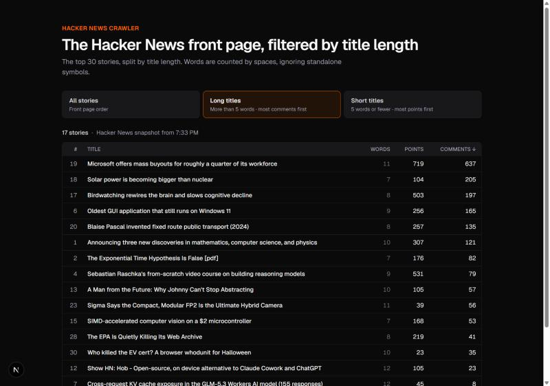
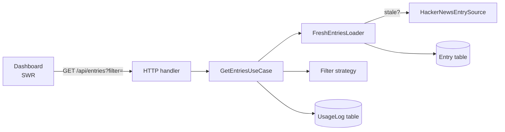

# HN Crawler

A Next.js app that crawls the first 30 entries of [Hacker News](https://news.ycombinator.com/) and filters them by title length. Every request is recorded as usage data.



| View         | Rule                                 | Order                                  |
| ------------ | ------------------------------------ | -------------------------------------- |
| All stories  | All 30 entries                       | Front page rank                        |
| Long titles  | Titles with **more than five** words | Number of comments, desc, ties by rank |
| Short titles | Titles with **five or fewer** words  | Points, desc, ties by rank             |

Words are counted by spaces, ignoring standalone symbols: `This is - a self-explained example` has 5 words.

## Quick start

Requires **Node.js 22.12+** (developed on Node 24) and npm.

```bash
npm install                 # also runs `prisma generate`
cp .env.example .env        # DATABASE_URL="file:./dev.db"
npx prisma migrate deploy   # creates the SQLite database
npm run dev                 # http://localhost:3000
```

There is no external service to set up: the database is a local SQLite file.

> **If your npm config has `ignore-scripts=true`**, install scripts don't run, so the native SQLite driver and the Prisma client are missing. Fix it with:
> `npm rebuild better-sqlite3 --ignore-scripts=false && npx prisma generate`

### Scripts

| Command                    | What it does                                             |
| -------------------------- | -------------------------------------------------------- |
| `npm run dev`              | Development server                                       |
| `npm test`                 | Unit and component tests (no database, no network)       |
| `npm run test:integration` | Repository tests against a real, freshly migrated SQLite |
| `npm run typecheck`        | TypeScript check across app and tests                    |
| `npm run lint`             | ESLint (Next.js rules + Prettier compatibility)          |
| `npm run format`           | Prettier, including Tailwind class sorting               |
| `npm run build`            | Production build                                         |

## API

`GET /api/entries` returns the stored entries, crawling Hacker News first if the data is stale.

| Query                  | Result                             |
| ---------------------- | ---------------------------------- |
| _(none)_               | All 30 entries in front page order |
| `?filter=long-titles`  | More than five words, by comments  |
| `?filter=short-titles` | Five words or fewer, by points     |

```json
{
  "entries": [
    {
      "rank": 19,
      "title": "Microsoft offers mass buyouts for roughly a quarter of its workforce",
      "points": 719,
      "commentCount": 637
    }
  ],
  "appliedFilter": "long-titles",
  "crawledAt": "2026-10-26T19:33:12.481Z"
}
```

| Status | When                                                      |
| ------ | --------------------------------------------------------- |
| `200`  | Entries returned                                          |
| `400`  | Unknown `filter` value; the body lists the allowed values |
| `502`  | Hacker News could not be reached or returned no entries   |
| `500`  | Any other failure                                         |

## Architecture

The code is split into layers. Dependencies only point inward, so the business rules have no knowledge of Next.js, Prisma or HTTP.

```
src/domain/          Business rules: Entry, word counting, filter strategies, repository interfaces
src/application/     Use cases: FreshEntriesLoader (TTL + crawling), GetEntriesUseCase (filter + usage log)
src/infrastructure/  Adapters: Hacker News scraper (fetch + Cheerio), Prisma repositories
src/http/            Request handling: validation and error-to-status mapping
src/composition-root.ts   The only place that wires concrete classes together
app/                 Next.js routes (thin) and the page
components/, lib/    UI components and the browser API client
```



## Design decisions

**Scrape, store, then filter.** Filters read stored entries instead of scraping on every request. A filter request costs a SQLite read (~2 ms) instead of a round trip to Hacker News (~700 ms).

**Re-crawl lazily, with a measured TTL.** There is no cron job: the first request after the TTL expires triggers the crawl. Hacker News publishes no refresh interval (`Cache-Control: private; max-age=0`, no `ETag`), so I sampled the front page every 20 seconds. Rankings and scores only changed about **every 2 minutes**, which suggests a periodically rebuilt page for logged-out visitors. `CRAWL_TTL_MS` is therefore 2 minutes: crawling more often would download identical HTML. It's one constant in `src/config.ts`.

**One crawl for concurrent requests.** If several requests find stale data at the same time, they all wait on a single in-flight crawl instead of each hitting Hacker News. This works because the composition root keeps one long-lived loader per server process.

**Crawls fail safely.** A failed crawl leaves the stored entries untouched, and the next request retries. A page that parses to zero entries (for example, if Hacker News changes its markup) is treated as a failure, so it can't wipe the stored data.

**Strategy pattern for filters.** Each filter is a class implementing `FilterStrategy`: it declares its `sortField` and applies it in `apply(entries)`, and the UI reads the same field for its sort indicator, so the two cannot disagree. A registry typed as `Record<FilterType, FilterStrategy>` maps the query parameter to its strategy. Adding a filter means adding one value, one class, and one UI label, and the build fails if the class or the label is missing. Long and short titles are defined from the same constant (`> 5` and `<= 5`), so every entry lands in exactly one filter.

**Ties keep the front page order.** When two entries have the same number of comments (or points), the one Hacker News ranked higher comes first. HN's rank already combines votes and recency, so it's a more meaningful tie-breaker than a second numeric field, and it matches the order readers already see. It follows from a stable sort over entries stored in rank order, and a test pins it.

**Word counting.** Split on whitespace and keep tokens that contain at least one letter or digit, using Unicode classes (`\p{L}\p{N}`) so titles like `Café` or `日本語` count correctly. Hyphenated words stay single words, punctuation attached to a word keeps the word, and standalone symbols (`-`, `|`, `—`) are dropped. Tokens like `C++` or `$5` count as words because they contain a letter or digit, while a token made only of emoji is dropped.

**Repositories behind interfaces.** The use cases depend on `EntryRepository` and `UsageLogRepository` from the domain layer, never on Prisma. Production uses Prisma implementations; unit tests use in-memory fakes of the same interfaces.

**SQLite via Prisma.** Zero setup for a reviewer, with real migrations in the repo. Every row of a crawl shares one `crawledAt` timestamp, which serves both as the batch identifier and as the staleness check. Replacing a batch is one transaction (`deleteMany` + `createMany`), so readers never see half a crawl.

**Usage data.** Every request that reaches the use case writes a `UsageLog` row, whether it succeeds or fails, so crawler failures leave a trace:

| Field            | Purpose                                                                                             |
| ---------------- | --------------------------------------------------------------------------------------------------- |
| `timestamp`      | When the request started                                                                            |
| `appliedFilter`  | `none`, `long-titles` or `short-titles`                                                             |
| `resultCount`    | Number of entries returned (`0` on failure)                                                         |
| `durationMs`     | Time spent serving the request                                                                      |
| `triggeredCrawl` | Whether this request had to wait for a crawl, its own or one already in flight (or one that failed) |
| `outcome`        | `success`, `source-unavailable` (Hacker News failed, `502`) or `error` (anything else, `500`)       |

Run `npx prisma studio` to browse it. Requests with an unknown filter are rejected with `400` at the HTTP boundary and are not logged: no work was done and no filter was applied, and logging them would mean storing arbitrary user input.

**UI.** SWR fetches on mount and uses each filter's URL as its cache key. `keepPreviousData` keeps the current table visible (dimmed) while the next filter loads, which also means a slow, outdated response can never overwrite the view you selected. The page has a loading skeleton, an error banner with Retry that keeps the last good data visible, an empty state, and accessibility markup (`aria-pressed`, `aria-sort`, live regions). On small screens the word count moves under each title so the sorted column always fits.

## Testing

| Suite           | Scope                                                                                                                                         |
| --------------- | --------------------------------------------------------------------------------------------------------------------------------------------- |
| **Unit**        | Word counting, filters, scraper (against a saved Hacker News page), TTL and crawl logic with a fake clock, usage logging, HTTP status mapping |
| **Components**  | The dashboard tested through user interactions (Testing Library + jsdom): loading, switching filters, error and retry                         |
| **Integration** | Prisma repositories against a real SQLite database migrated with `prisma migrate deploy` for each run                                         |

No test calls the live site. The parser runs against `tests/fixtures/hn-front-page.html`, a real snapshot, plus small inline HTML cases the snapshot doesn't contain (job postings without scores, more than 30 rows, an empty page).

## Commit history

The history is incremental: scaffold → schema → word count → scraper → repositories → filters → use case → API → UI → tests → docs, with each feature landing together with its tests. It ends with the fixes and refactors from a final self-review. Messages follow `<type>: <subject>` (`feat`, `fix`, `refactor`, `test`, `chore`, `docs`, `style`).

## Limitations and next steps

- **Single instance.** The crawl de-duplication lives in one server process. Several instances would need a shared lock, for example in the database.
- **Serverless hosting.** Most serverless platforms have an ephemeral filesystem, so deploying there would mean swapping SQLite for a hosted database. Only the Prisma adapter and the connection URL would change.
- **Serve stale data on failure.** When a re-crawl fails, the API could return the last stored entries with a warning instead of a `502`.
- **Faster first paint.** A Server Component could provide the first entries as SWR fallback data, removing the initial loading state.
- **Shareable filters.** Keeping the selected filter in the URL (`/?filter=long-titles`) would make views linkable.

## AI assistance

I built this with Claude Code as a pair programmer. The architecture was settled through a structured interview before any code was written. Each step was then implemented test-first, reviewed by me, and committed separately. I can walk through and justify every decision in this repository.
